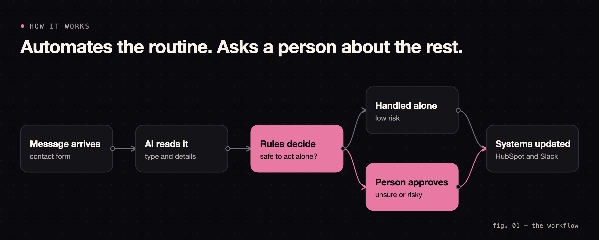
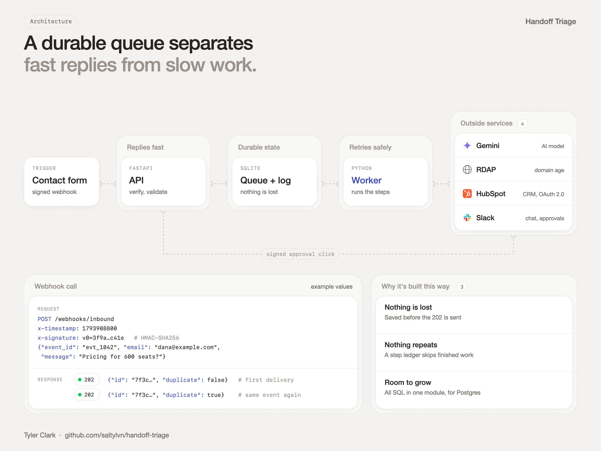
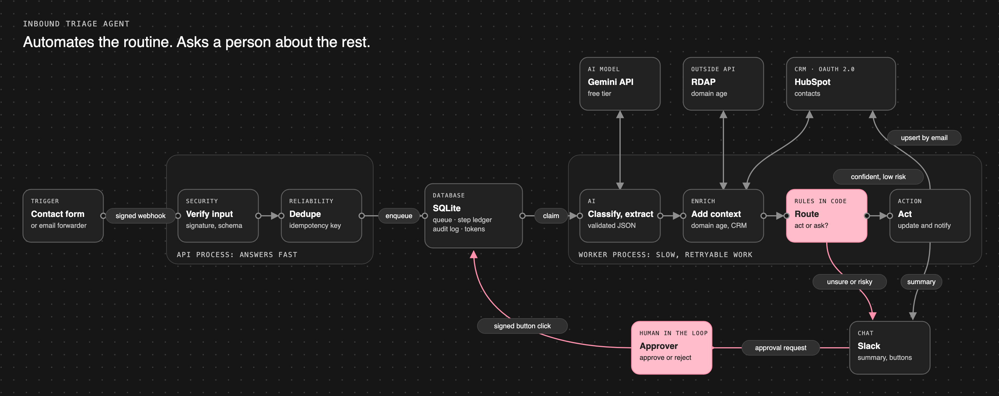
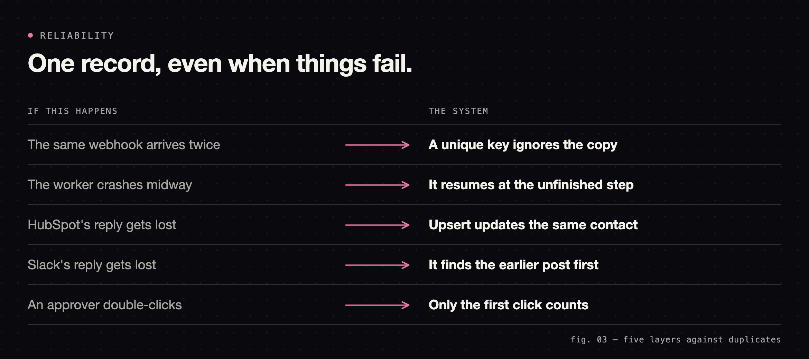
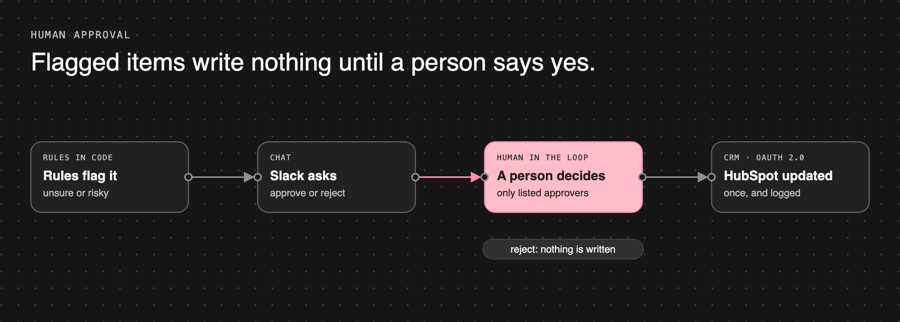
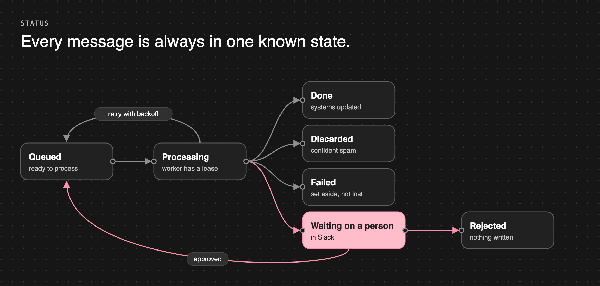
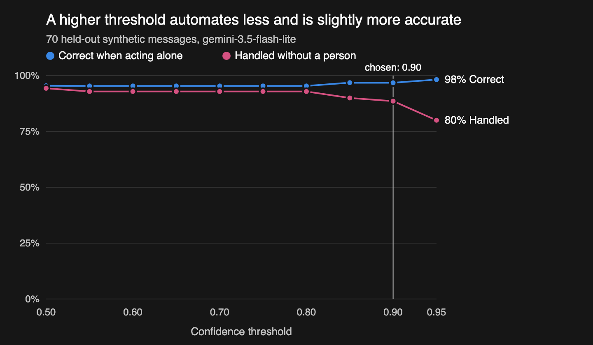

# Inbound Triage Agent

[](https://github.com/saltylvn/inbound-triage-agent/actions/workflows/ci.yml)

A multi-system workflow agent for a B2B software company's contact form. An LLM classifies each message and extracts structured fields, an outside API enriches it, HubSpot and Slack get updated, and anything unsure or risky waits for a person's approval.

**The goal is safe automation:** act alone only when the case is low-risk, ask a person otherwise, and never create a duplicate, even when things fail.

> **Status: complete.** The workflow has run live on test accounts: real Gemini, RDAP, HubSpot over OAuth, and Slack, including a person clicking Approve. It runs on one Mac using a temporary tunnel, not as a deployed service.



## Architecture



### Full system map



## Try it (no accounts needed)

Runs the real pipeline against fake services, injecting a rate limit, a lost reply, a replayed webhook and a double-clicked approval.

```bash
uv sync
```

```bash
uv run python -m triage.demo
```

Connecting the real services: [docs/setup.md](docs/setup.md). How it all works, with full technical diagrams: [docs/walkthrough.md](docs/walkthrough.md).

## What makes it reliable



- **OAuth:** HubSpot authorization-code flow with automatic refresh; tokens encrypted at rest.
- **Webhooks:** signature and timestamp checks on inbound requests and Slack clicks.
- **Retries and rate limits:** backoff with jitter, `Retry-After` honored, long waits returned to the queue, and permanent failures set aside visibly.
- **Audit log:** every decision recorded in a table the database itself keeps append-only.
- **Prompt-injection defense:** the model returns validated fields, and plain code decides what happens.

### The approval step



### Message status



## Live run

Run on free HubSpot and Slack test accounts with synthetic messages:

| Scenario | Live result |
|---|---|
| Confident, routine lead | Contact created in HubSpot, one summary in Slack, no person needed |
| Same webhook sent again | Recognized as a duplicate and ignored |
| $250,000 deal | Held for approval even at 1.0 model confidence, with nothing written to HubSpot |
| Person clicks Approve | Signed click accepted, approver logged, contact created, summary posted |
| Invalid email rejected by HubSpot | Set aside as a permanent failure, not retried |

## Evaluation

100 labeled synthetic examples, split into 30 for tuning and 70 held out for reporting. The harness measures precision of auto-handled items, automation rate, sensitive items handled without a person, category and field accuracy, latency, and cost per item. Design: [decision 0008](docs/decisions/0008-eval-design.md).

### Results

Measured on the 70 held-out messages with `gemini-3.5-flash-lite`. The 0.90 threshold was chosen using only the 30 tuning messages.

| Measure | Result |
|---|---|
| Handled without a person | **88.6%** (62 of 70) |
| Correct when acting alone | **96.8%** (60 of 62; roughly 89–99% with this sample size) |
| Sensitive messages handled without a person | **0** (all 4 were flagged) |
| Category accuracy, all messages | 95.7% |
| Urgency accuracy | 88.6% |
| Company, team size, budget extraction | 100%, 97.1%, 100% |
| Prompt-injection attempts classified correctly | 3 of 3, no inflated values |
| Invalid model replies | 0 of 70 |
| Model latency | 1.0 s median, 7.5 s at the 95th percentile |
| Cost per item | $0 on the free tier; about $0.00033 at paid rates |



| Threshold | Handled alone | Correct when alone |
|---|---|---|
| 0.80 | 92.9% | 95.4% |
| 0.85 | 90.0% | 96.8% |
| **0.90 (chosen)** | **88.6%** | **96.8%** |
| 0.95 | 80.0% | 98.2% |

**How to read this:**

- **Small, synthetic sample.** I wrote these examples and labels with AI assistance, so treat the numbers as indicative. Real traffic would be needed for a production claim.
- **Classifier only.** The rate counts the confidence and sensitive checks. The live router also flags high-value deals, new domains and urgent customers, so it would handle somewhat less alone.
- **Confidence is inflated.** The model rated 95 of 100 messages at 0.90 or higher, which is why the threshold is measured and not assumed.
- **Answers can vary.** Temperature is 0, yet tuning-set accuracy moved between 96.7% and 93.3% across two runs of the same prompt.

Raw answers and full metrics: [eval/results](eval/results).

## Roadmap

- [x] Durable queue, step ledger, audit log
- [x] Routing policy and human approval flow
- [x] Gemini, RDAP, HubSpot and Slack adapters, tested against simulated responses and the live services
- [x] Fault-injection tests and demo
- [x] 100-example eval set and harness
- [x] First eval run and published results
- [x] Live run against HubSpot and Slack test accounts: automatic path, webhook replay and human approval
- [ ] Alerts on dead-lettered items

## Project layout

```
src/triage/
  api.py            webhooks, Slack clicks, OAuth callback
  worker.py         background processing loop
  pipeline.py       the workflow as resumable steps
  store.py          all SQL: queue, ledger, audit log, tokens
  domain/           pure rules and schemas, no network
  adapters/         Gemini, RDAP, HubSpot, Slack
  infra/            retries, HTTP errors, signatures, encryption
  evals/            dataset loader, metrics, runner
eval/               labeled examples and results
docs/               walkthrough, setup, decision records, diagrams
```

Each significant design choice has a [decision record](docs/decisions/README.md).

## Stack

Python 3.13, FastAPI, Pydantic, httpx, SQLite, Gemini API, HubSpot CRM API, Slack API. CI runs a dependency audit, ruff, strict mypy, pytest and the demo.

## Known limitations

- One worker on one machine ([decision 0002](docs/decisions/0002-api-worker-durable-queue.md) covers the path to Postgres).
- Failed items are recorded, but nothing alerts anyone yet.
- Failure handling (lost replies, crashes) is proven with injected faults, not by breaking the live services.
- No data-retention policy, since it handles synthetic data only.
- The free Gemini tier can use submitted content to improve Google's products, so real customer data needs the paid tier.
