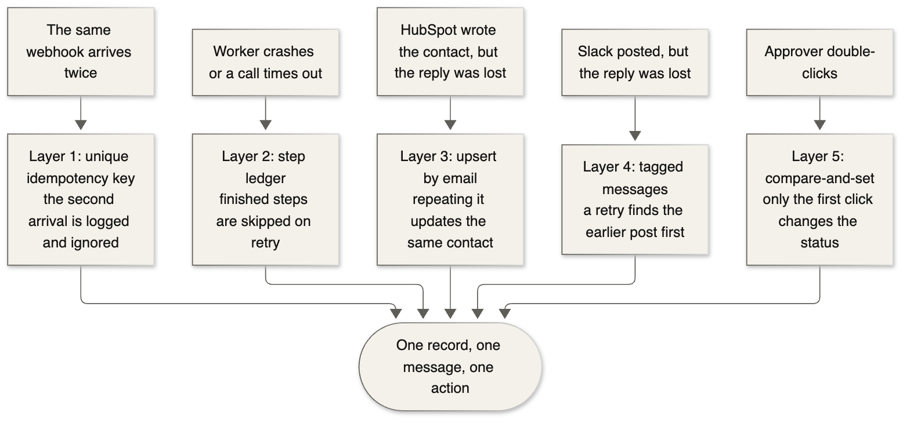
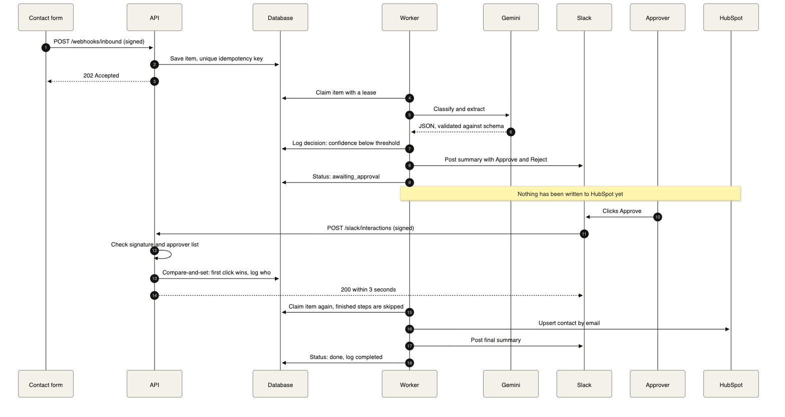
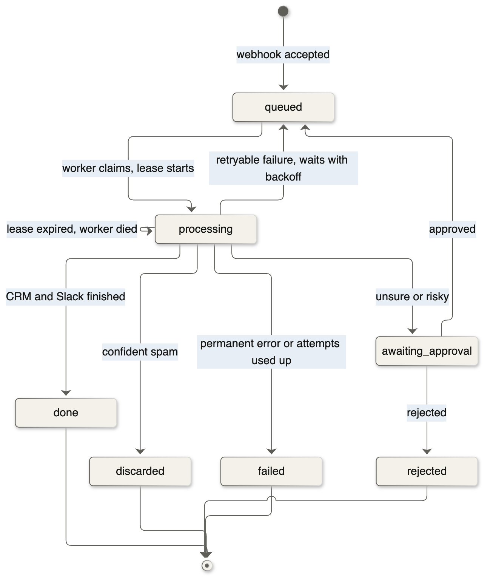

# Inbound Triage Agent

[](https://github.com/saltylvn/inbound-triage-agent/actions/workflows/ci.yml)

A multi-system workflow agent for a B2B software company's contact form. An LLM classifies each message and extracts structured fields, an outside API enriches it, HubSpot and Slack get updated, and anything unsure or risky waits for a person's approval.

**The goal is safe automation:** act alone only when the case is low-risk, ask a person otherwise, and never create a duplicate, even when things fail.

> **Status: in progress.** The pipeline, tests and fault-injection demo run today against fake services. Live HubSpot and Slack runs, eval results and the n8n version are next. No results are claimed until they've been measured.

## Architecture


## Try it (no accounts needed)

Runs the real pipeline against fake services, injecting a rate limit, a lost reply, a replayed webhook and a double-clicked approval.

```bash
uv sync
```

```bash
uv run python -m triage.demo
```

Connecting the real services: [docs/setup.md](docs/setup.md). How it all works: [docs/walkthrough.md](docs/walkthrough.md).

## What makes it reliable



- **OAuth:** HubSpot authorization-code flow with automatic refresh; tokens encrypted at rest.
- **Webhooks:** signature and timestamp checks on inbound requests and Slack clicks.
- **Retries and rate limits:** backoff with jitter, `Retry-After` honored, long waits returned to the queue, and permanent failures set aside visibly.
- **Audit log:** every decision recorded in a table the database itself keeps append-only.
- **Prompt-injection defense:** the model returns validated fields, and plain code decides what happens.

### The approval flow



### Item lifecycle



## Evaluation

100 labeled synthetic examples, split into 30 for tuning and 70 held out for reporting. The harness measures precision of auto-handled items, automation rate, sensitive items handled without a person, category and field accuracy, latency, and cost per item. Design: [decision 0008](docs/decisions/0008-eval-design.md).

**Results:** not yet run.

## Roadmap

- [x] Durable queue, step ledger, audit log
- [x] Routing policy and human approval flow
- [x] HubSpot, Slack, Gemini and RDAP adapters, tested against simulated responses
- [x] Fault-injection tests and demo
- [x] 100-example eval set and harness
- [ ] First eval run and published results
- [ ] Live run against HubSpot and Slack test accounts
- [ ] n8n version and written comparison
- [ ] Alerts on dead-lettered items

## Project layout

```
src/triage/
  api.py            webhooks, Slack clicks, OAuth callback
  worker.py         background processing loop
  pipeline.py       the workflow as resumable steps
  store.py          all SQL: queue, ledger, audit log, tokens
  domain/           pure rules and schemas, no network
  adapters/         Gemini, RDAP, HubSpot, Slack
  infra/            retries, HTTP errors, signatures, encryption
  evals/            dataset loader, metrics, runner
eval/               labeled examples and results
docs/               walkthrough, setup, decision records, diagrams
```

Each significant design choice has a [decision record](docs/decisions/README.md).

## Stack

Python 3.13, FastAPI, Pydantic, httpx, SQLite, Gemini API, HubSpot CRM API, Slack API. CI runs a dependency audit, ruff, strict mypy, pytest and the demo.

## Known limitations

- One worker on one machine ([decision 0002](docs/decisions/0002-api-worker-durable-queue.md) covers the path to Postgres).
- Failed items are recorded, but nothing alerts anyone yet.
- No data-retention policy, since it handles synthetic data only.
- The free Gemini tier can use submitted content to improve Google's products, so real customer data needs the paid tier.
