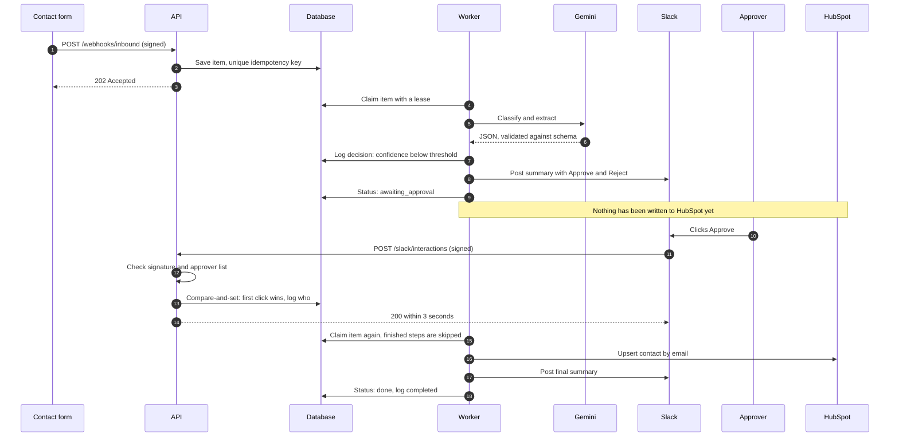
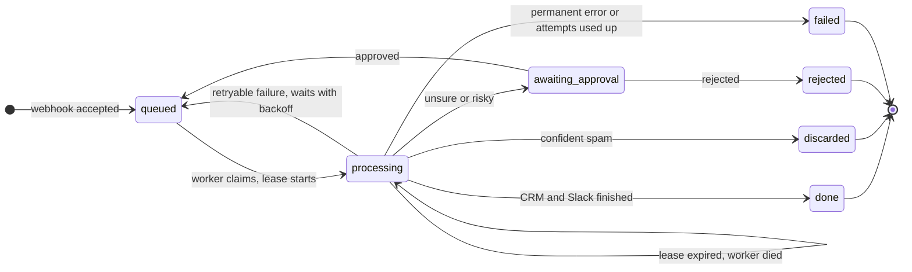

# Walkthrough

How the system works and why, in the order a message travels through it.

## The business problem

A software company's contact form receives sales leads, support requests, partner pitches, job seekers and spam in one inbox. Someone sorts them by hand, so good leads wait. Automating this is easy; automating it so nobody has to double-check it is the hard part.

**Safe automation** is the goal: the system acts alone only when the case is low-risk, sends everything else to a person, and never creates a duplicate, even when things fail.

## The journey of one message

1. **Arrival (`api.py`).** Checks the HMAC signature, including a timestamp so a captured request can't be replayed. Validates input with a strict schema, saves it with a unique key and replies 202. *Why so little?* Slow work here would make senders time out and retry.
2. **Claim (`store.py`).** The worker takes one item with a lease. If the worker dies, the lease expires and the item is picked up again.
3. **Classify (`adapters/gemini.py`).** The model returns JSON checked against a schema. The message is treated as untrusted data, and the sender's email isn't sent.
4. **Enrich (`pipeline.py`).** Domain age comes from RDAP and is optional: failure is noted and the item continues. The HubSpot lookup is required, because knowing someone is a customer changes the route.
5. **Route (`domain/routing.py`).** Plain, tested code decides between acting and asking a person.
6. **Approve (`api.py`).** Slack buttons call back with a signed request. Only listed approvers count, and only the first click wins.
7. **Act.** HubSpot upsert by email, then a Slack summary, each recorded in the step ledger.
8. **Audit.** Every decision goes in an append-only table, enforced by database triggers. See it with `python -m triage.trace`.

## The plumbing

| Concern | Where | Key idea |
|---|---|---|
| OAuth | `adapters/hubspot.py` | Authorization-code flow, auto refresh, encrypted storage |
| Webhooks | `infra/signature.py` | HMAC over timestamp and raw body |
| Retries | `infra/retry.py` | Only transient errors, with backoff and jitter |
| Rate limits | `infra/http.py`, `pipeline.py` | Honor `Retry-After`; long waits return to the queue |
| Idempotency | [decision 0003](decisions/0003-layered-idempotency.md) | Five layers |
| Logging | `migrations/0001_init.sql` | Append-only by trigger |

## Full technical detail

The README's images are simplified on purpose. These show every step and state.

Every step of an approval

Every status change

## Questions an interviewer may ask

- **Why not trust the model's confidence?** It's self-reported and inflated: the model rated 95 of 100 messages at 0.90 or higher. I chose the threshold on dev data and confirmed it on held-out test data.
- **What if HubSpot writes the contact but the reply is lost?** The retry repeats the upsert, which updates the same contact.
- **What about prompt injection?** The model can only return validated fields. Code decides actions, and injections are in the eval set.
- **What would you change for production?** Postgres with multiple workers, alerts on dead-lettered items, a data-retention policy, a paid LLM tier, and per-customer credentials.
- **When would you choose n8n over code?** n8n when a team needs to see and change the workflow itself, the logic is simple, and speed matters most. Code when the logic is complex or needs thorough tests, version control and precise control of failure handling, as this project does.
